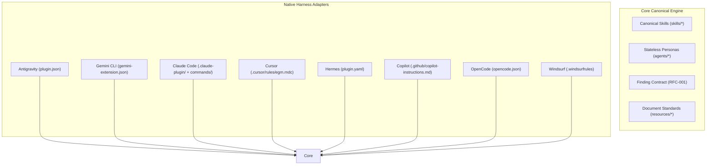

# Universal Multi-Agent EGM Bridge Specification

* **Author:** EGM Universal Architecture Working Group
* **Status:** In Review / Validated
* **Date:** 2026-10-23

--------------------------------------------------------------------------------

## 1. Overview & Problem Statement

### The Problem
Spec-Driven Development (SDD) with the Elephant-Goldfish Model was originally developed for Google's Antigravity and Gemini CLI harnesses. However, modern engineering teams operate across diverse agent ecosystems: Claude Code (Anthropic), Cursor (Anysphere), OpenAI Codex, Hermes (Nous Research), GitHub Copilot (Microsoft/OpenAI), Windsurf (Codeium), and open-source agents (OpenCode, Continue, Cline, Roo). Fragmenting EGM into separate forks for each harness causes massive documentation drift, broken skill references, and maintenance overhead.

### The Solution
The Universal Multi-Agent EGM Bridge provides a single canonical core of seven skills and nine personas, equipped with declarative native adapters that allow any compatible agent to discover, load, and execute EGM workflows natively.

--------------------------------------------------------------------------------

## 2. Requirements & Constraints

* **Requirement 1 (Single Source of Truth):** Skill instructions (`skills/`) and persona mandates (`agents/`) must remain identical across all harnesses.
* **Requirement 2 (Declarative Adapters):** Harness integration must use standard declarative manifests without requiring custom runtime daemons.
* **Requirement 3 (Standard Finding Contract):** All review findings across all agents must adhere to the 11-field schema (`RFC-001`).
* **Constraint 1 (No Invented APIs):** Harness mappings must only use capabilities officially supported by each target agent.
* **Constraint 2 (Safe Fallback):** Single-threaded agents must fall back to transparent, sequential reviews, outputting an explicit `[Sequential Fallback Mode: Running isolated sequential pass]` header, and never claim concurrency that did not occur.

--------------------------------------------------------------------------------

## 3. Goals & Non-Goals

### Goals
* Deliver native adapter configurations for Antigravity, Gemini CLI, Claude Code, Cursor, Codex, Hermes, Copilot, Windsurf, OpenCode, Continue, and Cline.
* Enforce strict 4-stage review sequencing: Zoom Out $\rightarrow$ Comprehension $\rightarrow$ Critic $\rightarrow$ Readiness.
* Provide 100% automated test coverage for persona completeness, finding contracts, routing, and safety boundaries.

### Non-Goals
* Re-implementing agent runtimes or writing closed-source IDE extensions.
* Supporting deprecated legacy workflow file formats (`.agents/workflows/`).

--------------------------------------------------------------------------------

## 4. Architectural Design & Component Layout

--------------------------------------------------------------------------------

## 5. Alternatives Considered

1. **Fork per Agent:**
   - *Pros:* Complete freedom to diverge syntax.
   - *Cons:* N-way drift, impossible to backport upstream improvements from Google EGM.
   - *Rejected:* Core philosophy demands single canonical source.
2. **Central Web API / MCP Server:**
   - *Pros:* Centralized execution engine.
   - *Cons:* Network latency, token billing complexity, requires user to host server.
   - *Rejected:* Local filesystem plugins provide zero latency, maximum privacy, and zero maintenance.

--------------------------------------------------------------------------------

## 6. Detailed Implementation Plan

### Target Manifest & Configuration Files
1. `plugin.json`: Native Antigravity plugin descriptor.
2. `gemini-extension.json`: Native Gemini CLI extension descriptor.
3. `.claude-plugin/plugin.json` & `.claude/commands/*.md`: Claude Code custom slash commands.
4. `.cursor/rules/egm.mdc` & `.cursorrules`: Cursor rules for Composer and Chat.
5. `plugin.yaml`: Hermes plugin manifest.
6. `opencode.json`: OpenCode agent and skills descriptor.
7. `.github/copilot-instructions.md`: GitHub Copilot system instructions.
8. `.windsurfrules`: Windsurf Cascade rules.
9. `.continue/rules.md` & `.clinerules`: Open source VS Code agent rules.

--------------------------------------------------------------------------------

## 7. Verification & Acceptance Testing Plan

* **Automated Unit Tests:** Pytest suite executing `test_subagent_personas.py`, `test_finding_contract.py`, `test_routing_and_pipeline.py`, `test_manifests_and_adapters.py`, `test_bootstrap_safety.py`.
* **Execution Verification:** End-to-end execution of all 7 skills across all adapters.
* **Link Integrity:** Zero broken markdown references or unresolvable internal anchors.
